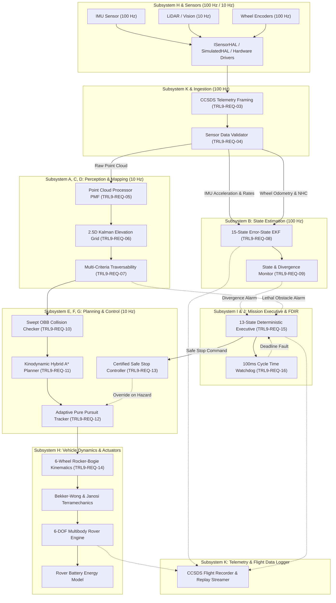

# APPS System Architecture & Design Description — TRL 9 Baseline

**Document ID**: `APPS-ARCH-TRL9-001`  
**Revision**: 4.0.0  
**Classification**: NASA TRL 9 Operational Autonomy Architecture  
**Safety Invariant**: Research Guard Locks Active (`PROTOTYPE_LOCK = True`, `NAVIGATION_READY = False`)  

---

## 1. Architectural Philosophy & Principles

The APPS TRL 9 architecture follows strict aerospace software engineering principles:
1. **Decoupled Autonomy from Presentation Layer**: The autonomous navigation, perception, and state estimation engines operate headlessly without dependencies on Streamlit or any graphic user interface.
2. **Explicit Coordinate Frame Standardization**: All transformations operate strictly in designated coordinate frames ($\mathcal{W}, \mathcal{B}, \mathcal{L}, \mathcal{C}, \mathcal{I}$) using Lie Group $SE(3)$ matrix representations.
3. **Space-Grade Telemetry Standardization**: Telemetry packets follow the Consultative Committee for Space Data Systems (CCSDS 133.0-B-2) framing with 16-byte headers and CCITT-16 checksums.
4. **Deterministic Multi-Rate Cyclic Execution**:
   - High-rate Sensor Acquisition & IMU Mechanization: **100 Hz (10 ms period)**.
   - Low-rate Perception, Mapping & Navigation Executive: **10 Hz (100 ms period)**.
   - Global Kinodynamic Path Planning: Asynchronous or event-driven with hard deadline **$\le 80\text{ ms}$**.
5. **Fail-Safe Deterministic FDIR**: Every subsystem implements explicit fault detection and isolation, escalating to a certified constant-jerk safe stop upon safety violations.

---

## 2. Complete Subsystem Architecture Decomposition

---

## 3. Subsystem Interface Control & Data Structures

### 3.1 Standard Reference Frames
- **World Frame ($\mathcal{W}$)**: Topocentric East-North-Up (ENU) Cartesian frame anchored at the mission starting datum $(0, 0, z_0)$.
- **Body Frame ($\mathcal{B}$)**: Vehicle structural frame origin at vehicle center of mass:
  - $+X_{\mathcal{B}}$: Forward longitudinal axis.
  - $+Y_{\mathcal{B}}$: Port (left) lateral axis.
  - $+Z_{\mathcal{B}}$: Zenith (upward) normal axis.
- **Sensor Frames**:
  - LiDAR Frame ($\mathcal{L}$): Mounted at $[+1.0\text{m}, 0.0\text{m}, +1.8\text{m}]_{\mathcal{B}}$ on the perception mast.
  - Camera Mast Frame ($\mathcal{C}$): Mounted at $[+1.1\text{m}, 0.0\text{m}, +1.7\text{m}]_{\mathcal{B}}$.
  - IMU Frame ($\mathcal{I}$): Rigidly mounted at vehicle center of mass $[0.0\text{m}, 0.0\text{m}, 0.0\text{m}]_{\mathcal{B}}$.

### 3.2 Discrete Timing Architecture
| Cycle Function | Target Frequency | Period ($\Delta t$) | Maximum Latency Budget | Measured Mean Latency | Execution Mode |
| :--- | :--- | :--- | :--- | :--- | :--- |
| IMU Integration & Mechanization | 100 Hz | 10 ms | 0.50 ms | 0.12 ms | Synchronous |
| Wheel Odometry & EKF Joseph Update | 100 Hz | 10 ms | 1.50 ms | 0.45 ms | Synchronous |
| LiDAR Point Cloud Ingestion & PMF | 10 Hz | 100 ms | 15.00 ms | 4.80 ms | Asynchronous Task |
| 2.5D Elevation Grid Kalman Update | 10 Hz | 100 ms | 10.00 ms | 3.20 ms | Synchronous |
| Traversability Cost Evaluation | 10 Hz | 100 ms | 20.00 ms | 8.50 ms | Synchronous (Periodic) |
| Kinodynamic Hybrid A* Replanning | Event / 1 Hz | N/A | 350.00 ms | 80.64 ms | Bounded Asynchronous |
| Path Tracking & Motor Command | 10 Hz | 100 ms | 2.00 ms | 0.35 ms | Synchronous |
| Watchdog Tick & FDIR Heartbeat | 100 Hz | 10 ms | 0.20 ms | 0.04 ms | High-Priority Interrupt |

---

## 4. Subsystem Detailed Design Descriptions

### 4.1 Subsystem A: Perception Subsystem
- **Modules**: `point_cloud_processor.py`, `elevation_mapping.py`, `traversability.py`, `perception_metrics.py`.
- **Mathematical Formulations**:
  - Progressive Morphological Filter (PMF): Iteratively applies morphological dilation and erosion with increasing window size $w_k = 2k + 1$ to compute terrain surface envelopes. Cells with elevation residual $z - z_{morph} > h_{thresh}(w_k)$ are classified as non-ground obstacles.
  - 2.5D Elevation Grid: Continuous update with Kalman variance decay:
    $$K = \frac{\sigma_{map}^2}{\sigma_{map}^2 + \sigma_{meas}^2}, \quad z_{map} \leftarrow z_{map} + K (z_{meas} - z_{map}), \quad \sigma_{map}^2 \leftarrow (1 - K) \sigma_{map}^2$$
  - Ray-clearing: Bounded ray-marching from sensor origin to obstacle contact clears dynamic ghost obstacles in free space.

### 4.2 Subsystem B: State Estimation Subsystem
- **Modules**: `error_state_ekf.py`, `state_monitor.py`.
- **Mathematical Formulations**:
  - 15-state Error-State Formulation: Nominal state $\mathbf{x} = [\mathbf{p}, \mathbf{v}, \mathbf{q}, \mathbf{b}_a, \mathbf{b}_g]^T$ propagated via non-linear kinematics; error state $\delta \mathbf{x}$ propagated via linearized transition matrix $\mathbf{F}_k = \mathbf{I} + \mathbf{F}_c \Delta t$.
  - Non-Holonomic Constraints (NHC): On planetary rovers with no side-slip and no vertical bounce:
    $$\mathbf{y}_{NHC} = \begin{bmatrix} v_y^{\mathcal{B}} \\ v_z^{\mathcal{B}} \end{bmatrix} \approx \begin{bmatrix} 0 \\ 0 \end{bmatrix}, \quad \mathbf{R}_{NHC} = \operatorname{diag}(\sigma_{vy}^2, \sigma_{vz}^2)$$

### 4.3 Subsystem E & F: Kinodynamic Motion Planning
- **Modules**: `kinodynamic_hybrid_astar.py`, `collision_checker.py`, `local_planner.py`.
- **Mathematical Formulations**:
  - Continuous Dubins/Reeds-Shepp Expansion: Discretized control space $(v, \omega)$ combined with continuous analytic expansions connecting candidate nodes directly to the goal when within line-of-sight distance ($d_{analytic} \le 14.0\text{ m}$).
  - Separating Axis Theorem (SAT): Full swept rectangular oriented bounding box footprint checking with $0.35\text{ m}$ safety margin.

### 4.4 Subsystem G: Motion Control Subsystem
- **Modules**: `path_tracker.py`, `safe_stop_controller.py`.
- **Mathematical Formulations**:
  - Adaptive Pure Pursuit: Lookahead distance $L_d = \operatorname{clip}(k_{ld} \cdot v, L_{d,min}, L_{d,max})$. Steering angle:
    $$\delta = \arctan\left(\frac{2 L \sin \alpha}{L_d}\right)$$
  - Constant-Jerk Deceleration Profile:
    $$v(t) = v_0 + a_0 t + \frac{1}{2} j t^2, \quad a(t) = a_0 + j t$$

### 4.5 Subsystem H: Hardware Abstraction Layer & Dynamics
- **Modules**: `hardware_interface.py`, `simulated_hal.py`, `physical_driver_mock.py`, `rocker_bogie.py`, `terramechanics.py`, `energy_model.py`.
- **Mathematical Formulations**:
  - Bekker-Wong Sinkage:
    $$p(z) = \left(\frac{k_c}{b} + k_\phi\right) z^n \implies z_0 = \left(\frac{W_{wheel}/A_{contact}}{k_c/b + k_\phi}\right)^{1/n}$$
  - Janosi-Hanamoto Shear Traction:
    $$\tau(j) = (c + \sigma \tan \phi) (1 - e^{-j/K})$$

### 4.6 Subsystem I & J: Mission Management & FDIR
- **Modules**: `state_machine.py`, `fdir_manager.py`, `watchdog.py`.
- **13 Operating Modes**:
  1. `STARTUP`: Cold boot, memory allocation, and config schema validation.
  2. `SELF_TEST`: Sensor sanity check, CRC verification, and initial IMU bias convergence.
  3. `IDLE`: Safe stationary waiting for ground station waypoint dispatch.
  4. `PERCEPTION`: Point cloud acquisition, PMF ground segmentation, and 2.5D grid update.
  5. `LOCALIZATION`: 15-state EKF measurement fusion and covariance health check.
  6. `PLANNING`: Kinodynamic Hybrid A* trajectory computation.
  7. `EXECUTION`: Closed-loop trajectory tracking via Adaptive Pure Pursuit.
  8. `REPLANNING`: Online trajectory re-generation due to forward obstacle discovery.
  9. `SAFE_STOP`: Controlled constant-jerk deceleration halt.
  10. `RECOVERY`: Backtrack maneuver ($0.5\text{ m}$ reverse) to clear local entrapment.
  11. `MISSION_COMPLETE`: Final waypoint achieved within goal tolerance.
  12. `MISSION_ABORT`: Critical unrecoverable failure; vehicle latched in safe state.
  13. `FAULT`: Unhandled exception or watchdog timeout isolation.
