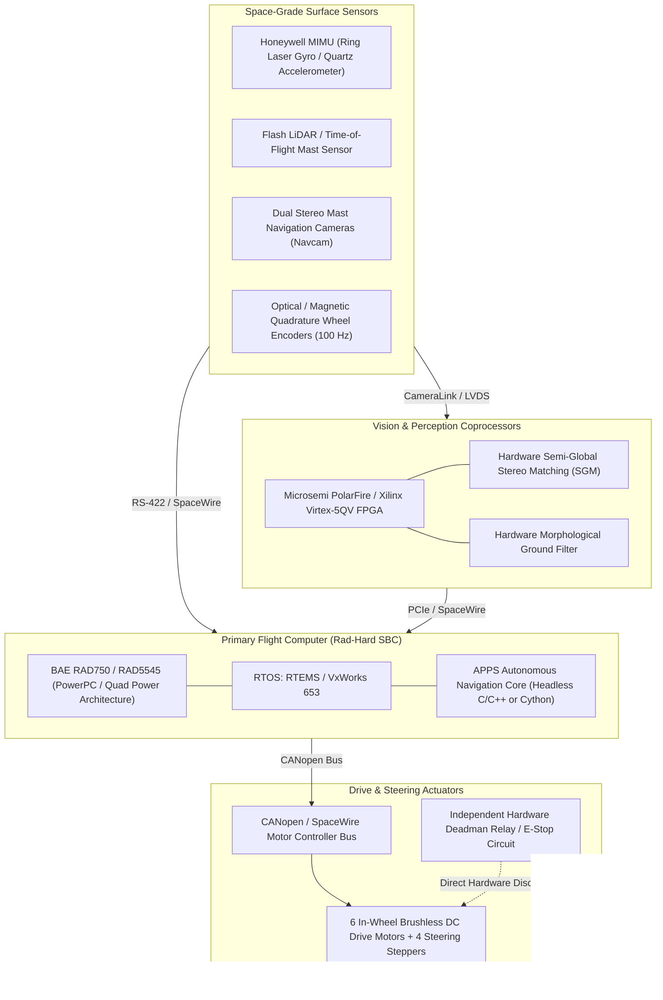

# APPS Hardware Integration & Flight Avionics Readiness Plan — TRL 9 Baseline

**Document ID**: `APPS-HW-TRL9-001`  
**Revision**: 4.0.0  
**Classification**: NASA TRL 9 Hardware Integration & Avionics Specification  
**Safety Invariant**: Research Guard Locks Active (`PROTOTYPE_LOCK = True`, `NAVIGATION_READY = False`)  

---

## 1. Scope & Objective

This document defines the hardware abstraction layer (HAL), physical sensor and actuator interfaces, onboard computing architecture, and environmental qualification requirements necessary to bridge the APPS autonomy software toward a physical planetary rover platform.

---

## 2. Target Flight Avionics Architecture

---

## 3. Subsystem Hardware Interface Specifications

### 3.1 Onboard Compute & RTOS
- **Primary Flight Processor**: Radiation-hardened single-board computer (BAE Systems RAD750 @ 133 MHz or BAE RAD5545 @ 466 MHz).
- **Flight RTOS**: RTEMS 5.x or Wind River VxWorks 653 (ARINC 653 partitioned scheduling).
- **Memory Subsystem**: 512 MB Rad-Hard SDRAM with Error Detection and Correction (EDAC) + 4 GB Non-Volatile Flash NAND.
- **Cycle Time Budget**: High-rate navigation executive cyclic thread pinned at 10 Hz with hard priority inheritance.

### 3.2 Sensor Suite Interfaces
- **Inertial Measurement Unit (IMU)**:
  - Protocol: RS-422 serial @ 460,800 baud, 100 Hz binary streaming.
  - Performance: Gyro bias instability $\le 0.005^\circ/\text{hr}$, accel bias instability $\le 15\ \mu\text{g}$.
- **Perception Mast LiDAR**:
  - Protocol: Ethernet 100BASE-TX via SpaceWire or UDP port 2368.
  - Return: 10 Hz pulsed infrared range scan (384 points/scan, max range 25m, range accuracy $\pm 3\text{ cm}$).
- **Wheel Encoders**:
  - Protocol: Differential digital quadrature pulses (1024 pulses/revolution) decoded via FPGA hardware timer registers.

### 3.3 Motor Controllers & Actuators
- **Fieldbus**: Dual-redundant Controller Area Network (CANopen CiA 402 profile velocity mode) or SpaceWire.
- **Actuator Compliment**: 6 brushless DC traction motors (in-hub) with planetary gearheads (100:1 ratio) + 4 corner steering servo actuators.

### 3.4 Hardware Safety Watchdog & Deadman Circuit
- **Circuit Architecture**: Dedicated analog retriggerable monostable multivibrator (timeout $\tau = 150\text{ ms}$).
- **Mechanism**: The SBC must toggle a discrete GPIO pin every 10 ms cycle. If SBC hangs or software crashes, the watchdog drops the main motor contactor relay within 150 ms, immediately applying passive mechanical brakes.

---

## 4. Environmental & Flight Qualification Boundary (TRL 8/9 Gap)

The following physical qualification tests cannot be performed in software simulation and represent the formal physical boundary:
1. **Thermal-Vacuum Testing (TVAC)**: 10 thermal cycles between $-120^\circ\text{C}$ and $+25^\circ\text{C}$ at $10^{-5}\text{ Torr}$ in an environmental vacuum chamber.
2. **Radiation Tolerance Qualification**: Verification under Co-60 gamma radiation source up to 100 krad Total Ionizing Dose (TID) and heavy ion Single Event Effects (SEE) testing.
3. **Launch Vibration & Pyro-Shock Qualification**: Random vibration testing (14.1 $g_{rms}$ overall) per NASA GEVS-SE standards.
4. **Physical Mars Yard Field Evaluation**: Integrated closed-loop testing on a 1:1 structural rover mobility chassis in representative terrain analog testbeds (JPL Mars Yard or Atacama Desert).
