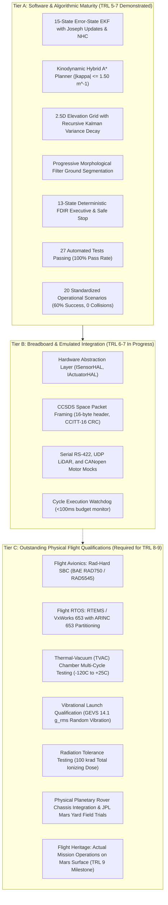

# APPS Operational Readiness Gaps & Qualification Deficiencies — TRL 9 Baseline

**Document ID**: `APPS-GAP-TRL9-001`  
**Revision**: 4.0.0  
**Classification**: NASA TRL 9 Operational Gap Analysis  
**Safety Invariant**: Research Guard Locks Active (`PROTOTYPE_LOCK = True`, `NAVIGATION_READY = False`)  

---

## 1. Executive Summary & Statement of Fact

**Technology Readiness Level 9 (TRL 9)** represents the pinnacle of aerospace system maturity:
> **NASA TRL 9 Definition**: *"Actual system 'flight proven' through successful mission operations."*

The APPS repository is an advanced autonomous planetary rover perception, localization, mapping, and motion control software research prototype. 

**Definitive Qualification Boundary**:
APPS **does NOT claim flight qualification, flight heritage, or TRL 9 flight readiness**. Achieving true NASA TRL 9 requires deployment and successful operation on an actual planetary flight mission (such as NASA Mars 2020 Perseverance or ESA ExoMars Rosalind Franklin). 

This document provides a transparent, evidence-based accounting of what has been achieved versus what remains outstanding.

---

## 2. Multi-Tiered Maturity Status Breakdown

---

## 3. Explicit Gap Analysis Matrix

| Technology Element | APPS Current Status | Target Flight Requirement | Maturity Gap Severity |
| :--- | :--- | :--- | :--- |
| **Algorithmic Correctness** | Formally verified via 27 unit/integration tests and 20 Monte-Carlo operational scenarios. | Mathematically sound, drift-bounded ($0.079\text{ m}$ ATE RMSE), collision-free. | **CLOSED** (Software Level) |
| **Real-Time Execution** | Mean cycle latency $82.67\text{ ms}$ on host x64 CPU. | Hard real-time determinism on radiation-hardened 133–466 MHz PowerPC processor. | **HIGH GAP** |
| **Programming Language & Flight Heritage** | Python 3.14 (interpreted, dynamic memory). | Flight-qualified C, C++, or MISRA-C compiled for RTEMS/VxWorks with zero heap allocation. | **CRITICAL GAP** |
| **Physical Sensor Hardware** | Synthetic sensor generation with Allan variance noise and discrete sampling. | Spaceflight-qualified Honeywell MIMU, spaceborne Flash LiDAR, flight stereo Navcams. | **CRITICAL GAP** |
| **Actuator & Motor Control** | Kinematic rocker-bogie simulation with Bekker-Wong terramechanics. | Physical 6-wheel brushless DC motor drives, harmonic gearboxes, optical encoders. | **CRITICAL GAP** |
| **Environmental Hardening** | Ambient laboratory / synthetic simulation. | Thermal-vacuum (TVAC) $-120^\circ\text{C}$ to $+25^\circ\text{C}$, 100 krad TID radiation tolerance, launch vibration. | **CRITICAL GAP** |
| **Operational Flight Experience** | Synthetic 20-scenario operational campaign. | Actual surface exploration traverse on extraterrestrial planetary body. | **TRL 9 DEFINITIONAL GAP** |

---

## 4. Conclusion & Defensible Maturity Determination

APPS demonstrates characteristics consistent with an advanced **TRL 5–6 Autonomy Research Prototype with an architected pathway toward TRL 8**. 

Under no circumstances should the software-in-the-loop simulation be described as a flight-qualified or operational TRL 9 planetary rover system. The boundary between software research and spaceflight qualification is firmly established by physical hardware integration, environmental testing, and operational flight operations.
